# RebbitMQ_HM
Домашнее задание к занятию «Очереди RabbitMQ» Dunaevskaya Olga

 # Задание 1
 web-интерфейс: 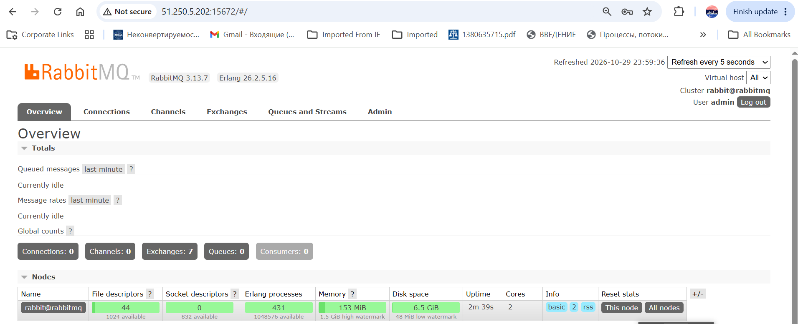

 # Задание 2
  Очередь после запуска produser: 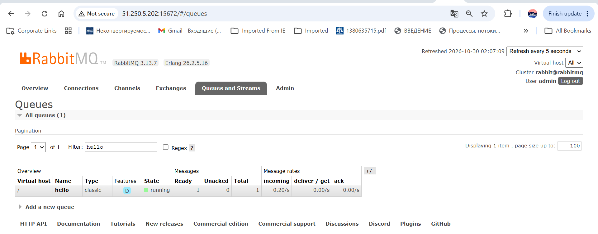
  Обработка очереди consumer: 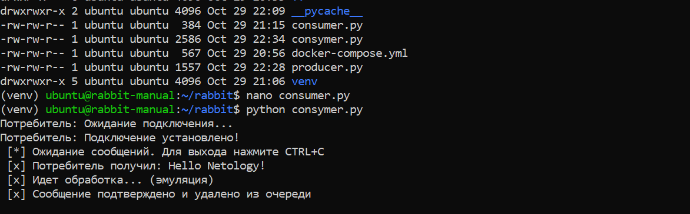
  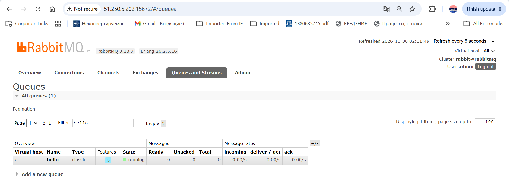

 # Задание 3
 
   Ноды: 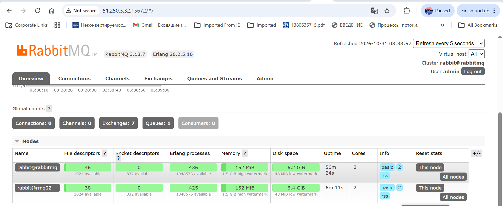
   Политика ha-all: ![alt tex]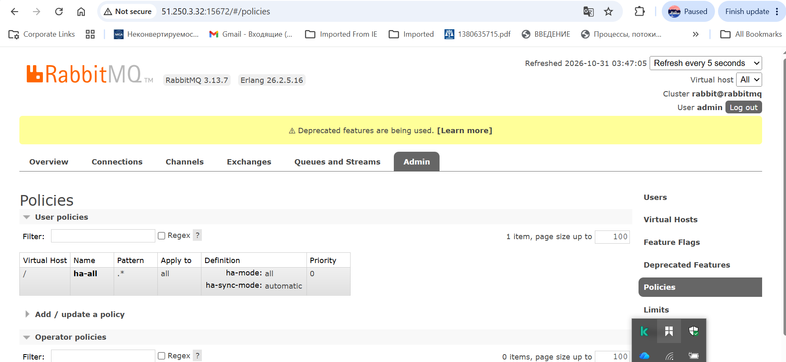
   Кластер, нода 1: 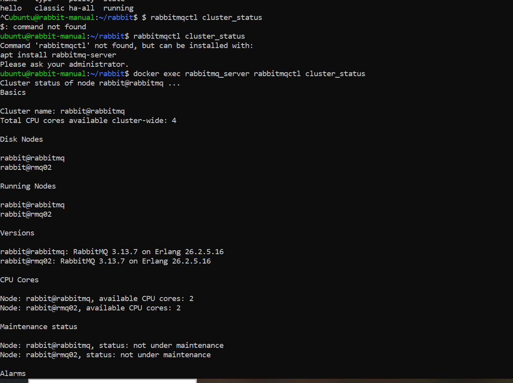
   Кластер, нода 2: 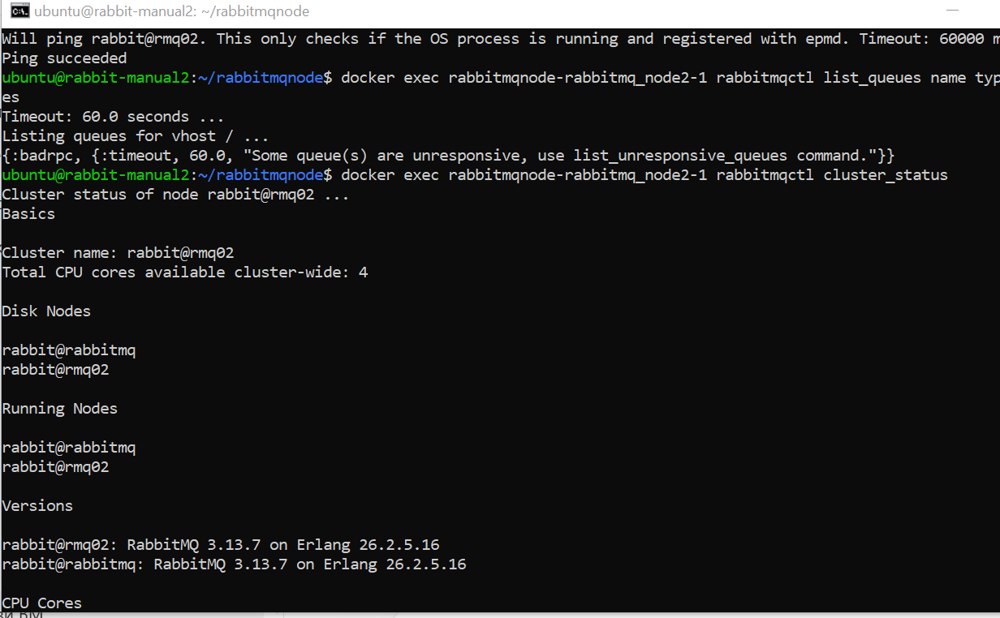
   Продьюсер повторный запуск: 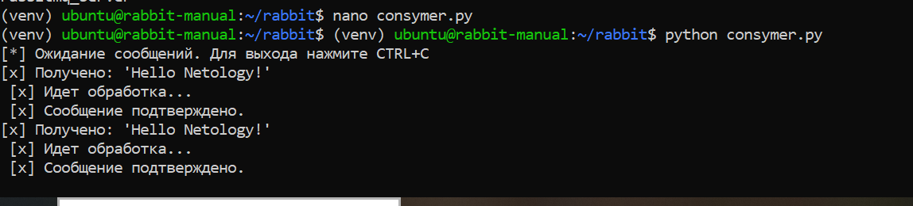
   Нода 1: 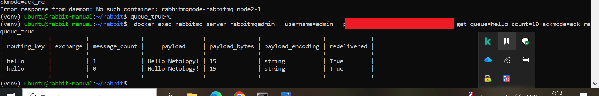
   Нода 2: 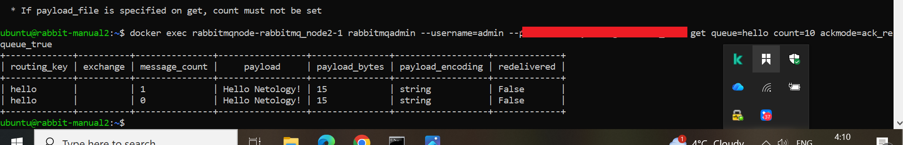
   Отключение ноды 1, запуск консьюмера  и обработка нодой 2: 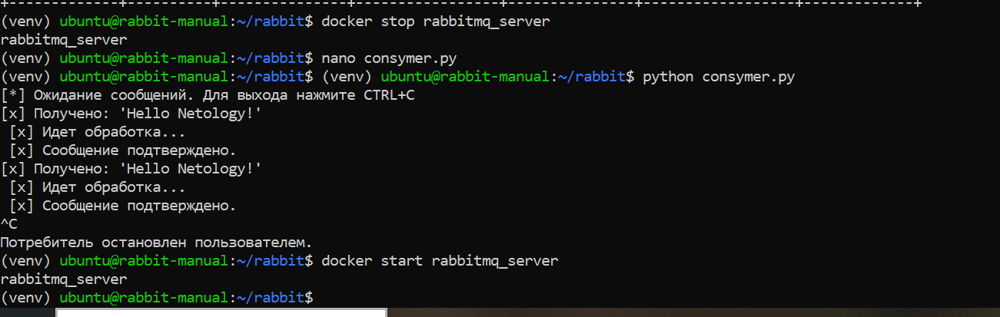
   
   
   
